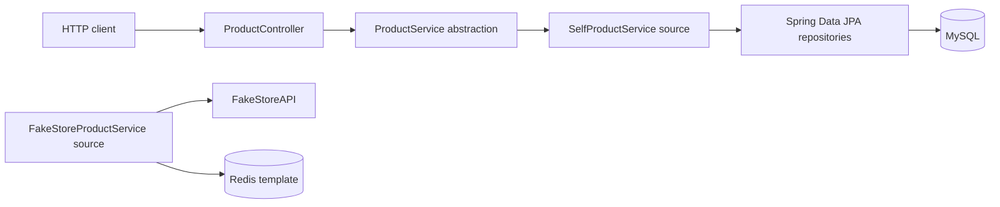

# Java E-Commerce Backend | Product Catalog & Payment Integration

**A career transition into software engineering, built one backend layer at a time.**

I bring a business education and more than five years of experience in e-commerce operations and technical support. That experience gave me a practical view of the problems behind online commerce: product information, seller workflows, customer issues, and the importance of dependable systems. I’m now applying that operational perspective to software engineering—building with Java, Spring Boot, REST APIs, data modeling, persistence, caching, and payment-provider SDKs.

This portfolio project explores the backend foundations of an e-commerce experience. The product catalog and payment integration are maintained in **two separate repositories**, so their current scope and connection are described explicitly below.

- **Product catalog:** [ScalerEcommerceProject — source on master](https://github.com/FaiazS/ScalerEcommerceProject/tree/master)
- **Payment-link prototype:** [PaymentGateWayIntegration — source on master](https://github.com/FaiazS/PaymentGateWayIntegration/tree/master) · [Payment repository README](https://github.com/FaiazS/PaymentGateWayIntegration/blob/master/README.md)

> Independent learning projects inspired by common e-commerce workflows. They are not affiliated with or endorsed by Amazon, Razorpay, or Stripe.

## The engineering story

I approached this project as a way to turn real-world e-commerce context into backend engineering practice. The product service explores how an API can expose catalog operations through a controller, delegate work to service abstractions, model product and category data, and use repositories for persistence. A separate project explores the payment-provider boundary: accepting an order reference and generating hosted payment links through Razorpay and Stripe SDKs.

That work has helped me practice an essential backend habit: separating responsibilities and asking what a system must guarantee when data, external services, and money are involved. The repositories are learning prototypes, and I have documented the implementation boundaries and next steps rather than presenting unfinished integrations as production features.

## What the source demonstrates

| Engineering area | Evidence in the repositories |
|---|---|
| Java backend development | Java 17 and Spring Boot applications |
| REST APIs | Spring MVC controllers, request DTOs, and product/payment endpoints |
| Domain modeling | JPA product and category entities with a many-to-one relationship |
| Persistence | Spring Data JPA repositories and MySQL configuration in the product service |
| Catalog operations | Product retrieval, creation, pagination, sorting, and not-found handling in the source |
| External services | FakeStoreAPI adapter code and separate Razorpay/Stripe SDK integration code |
| Caching concepts | Redis configuration and a cache path in the FakeStore product adapter |
| System boundaries | Separate product-catalog and payment-link repositories |

## Product catalog service

The main repository is a Java 17 / Spring Boot product service. Its source is organized into REST controllers, DTOs, models, repositories, service abstractions, and application-level exception handling.

### Catalog operations represented in the code

- List products and retrieve a product by ID.
- Accept a product-creation request and associate the product with an existing category or a new category.
- Retrieve paginated products with name and price sorting.
- Persist product and category entities through Spring Data JPA repositories.
- Return an HTTP 404 response for the product-not-found exception.
- Explore external product retrieval through a FakeStoreAPI adapter.
- Configure Redis and explore caching within that adapter.

**Persistence detail:** the product repository in the reviewed source uses Spring Data JPA with MySQL configuration. Although the payment repository includes JDBC dependencies, the catalog code reviewed here is not a JDBC repository implementation.

### Request flow

The product controller selects the `SelfProductService` qualifier. The FakeStoreAPI adapter and Redis cache path are separate source code and should not be read as the active controller flow in the current branch.

### Routes declared by the controller

The class-level mapping and method-level mappings both include `/products`, so the current declared paths contain a repeated segment:

| Method | Current route | Operation |
|---|---|---|
| GET | `/products/products` | List products |
| GET | `/products/products/paginatedProducts?pageNumber={n}&pageSize={n}` | Paginated product list |
| GET | `/products/products/{id}` | Retrieve a product |
| POST | `/products/products` | Create a product |

Normalizing the duplicate prefix is a clear next API cleanup.

## Separate payment integration

Payment-provider code lives in the standalone [PaymentGateWayIntegration repository](https://github.com/FaiazS/PaymentGateWayIntegration/tree/master), with its own [implementation-focused README](https://github.com/FaiazS/PaymentGateWayIntegration/blob/master/README.md).

The source exposes `POST /payments`, accepts an `orderId`, and delegates to provider-specific payment-link code:

- **Razorpay path:** constructs a demo INR payment-link request with a fixed amount, order reference, and expiry.
- **Stripe path:** explores creating a recurring INR price and a hosted payment link.
- **Provider selection:** currently alternates between providers using an in-memory request counter.

These are payment-link integration experiments. The payment repository is **not currently connected** to the product service’s catalog, cart, or order lifecycle, and the source does not demonstrate an end-to-end checkout. The README and code link above let reviewers inspect the implementation directly.

## Technology

- Java 17
- Spring Boot and Spring MVC
- Spring Data JPA and MySQL (product-service source)
- Redis configuration and adapter-level cache exploration
- FakeStoreAPI
- Razorpay Java SDK and Stripe Java SDK (separate payment project)
- Maven

## What I’m learning to build next

The next iteration is about turning the separate learning pieces into a reliable, testable system:

1. Make the Spring service implementations concrete and confirm application startup.
2. Normalize the product routes and document request and response examples.
3. Choose and wire an explicit source of truth for product data.
4. Make Redis cache misses null-safe, align cache keys, and define expiration/invalidation.
5. Load payment credentials securely and remove personal data from payment fixtures.
6. Select payment providers explicitly rather than by request order.
7. Derive payment amounts from persisted orders and connect payment status to an order lifecycle.
8. Add signed webhook verification, idempotency, and automated tests before treating the payment flow as production-ready.

The payment source currently contains a committed test credential and personal customer details. Those should be removed and the credential rotated before the repository is shared further. No secrets or personal values are reproduced in this README.

## About

My transition from business and e-commerce operations into software engineering is grounded in curiosity, structured problem-solving, and consistent hands-on learning. This project lets me connect the workflows I have supported professionally with the technical foundations behind backend services—and gives hiring teams a direct view of how I think about APIs, data, integrations, and system reliability.

**Explore the code:** [Product catalog service](https://github.com/FaiazS/ScalerEcommerceProject/tree/master) · [Separate Razorpay and Stripe payment integration](https://github.com/FaiazS/PaymentGateWayIntegration/tree/master)

