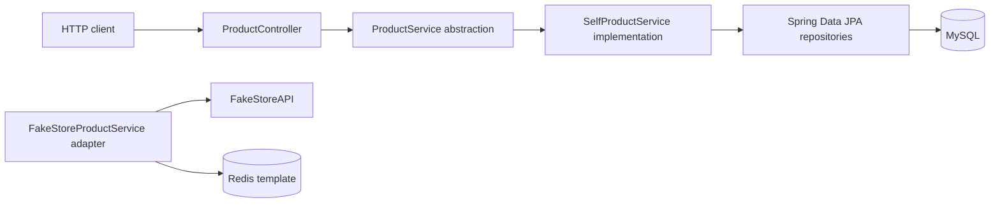

# Java E-Commerce Backend Portfolio

A backend engineering portfolio project exploring the foundations of an e-commerce platform: REST API design, product catalog modeling, pagination and sorting, relational persistence, external catalog integration, caching concepts, and payment-link integrations.

The work is split across two repositories:

- **Product catalog service:** [ScalerEcommerceProject](https://github.com/FaiazS/ScalerEcommerceProject/tree/master)
- **Separate payment integration prototype:** [PaymentGateWayIntegration](https://github.com/FaiazS/PaymentGateWayIntegration/tree/master)

This is an independent learning project inspired by common e-commerce systems. It is not affiliated with Amazon or any payment provider.

## Project at a glance

| Area | What the source demonstrates |
|---|---|
| Backend framework | Java 17 and Spring Boot |
| API design | Spring MVC REST controllers and request DTOs |
| Catalog domain | Product and category entities, with a many-to-one product/category relationship |
| Data access | Spring Data JPA repositories backed by MySQL configuration |
| Catalog operations | Product lookup, listing, creation, and paginated/sorted retrieval in the service layer |
| External API exploration | FakeStoreAPI product retrieval adapter |
| Caching exploration | Redis template configuration and a cache path in the FakeStore adapter |
| Payment integration prototype | Separate Spring application with Razorpay and Stripe SDK integrations that generate payment links |

## Product catalog service

The main repository is a Spring Boot product service. Its code is organized around controllers, DTOs, domain models, repositories, and service abstractions.

### Catalog capabilities represented in the source

- Retrieve products and look up a product by ID.
- Create a product from a request DTO, associating it with an existing category or creating the category when needed.
- Retrieve a paginated product collection ordered by product name and price.
- Persist product and category entities through Spring Data JPA repositories.
- Map a product-not-found exception to an HTTP 404 response.
- Call FakeStoreAPI for product data through a separate adapter implementation.
- Configure a Redis template and explore caching for individual products in the external-catalog adapter.

### Request flow



The controller currently selects the `SelfProductService` qualifier. The FakeStoreAPI and Redis code live in a separate service adapter; they should be treated as an integration experiment in the current source, not as a verified part of the controller''s active request path.

### Current controller mappings

The controller declares a class-level `/products` mapping and repeats `/products` in its method mappings. As written, the routes are:

| Method | Route | Purpose |
|---|---|---|
| GET | `/products/products` | List products |
| GET | `/products/products/paginatedProducts?pageNumber={n}&pageSize={n}` | Return a page of products |
| GET | `/products/products/{id}` | Retrieve one product |
| POST | `/products/products` | Create a product |

A cleanup pass could remove the repeated segment to produce the more conventional `/products` route family.

## Separate payment integration repository

Payment work is in its own Spring Boot application: [PaymentGateWayIntegration](https://github.com/FaiazS/PaymentGateWayIntegration/tree/master). It contains a `POST /payments` controller that accepts an order ID and delegates to Razorpay or Stripe payment-link generation code.

The current controller alternates providers based on an in-memory request counter. The Razorpay example constructs a demo INR payment link with a fixed amount and an expiry; the Stripe example creates a recurring-price/payment-link flow. These are provider-integration prototypes, not a production order-payment system. The payment repository is separate and is not wired into the product service''s checkout flow in the code reviewed here.

### Payment request shape

```json
{
  "orderId": 123
}
```

The response is currently the provider SDK''s payment-link representation. The request and response contracts, provider selection, amount calculation, and order lifecycle need further refinement before these repositories can be described as a complete checkout integration.

## Technology

- **Java 17**
- **Spring Boot / Spring MVC**
- **Spring Data JPA**
- **MySQL**
- **Redis** (configuration and adapter-level cache exploration)
- **FakeStoreAPI**
- **Razorpay Java SDK**
- **Stripe Java SDK**
- **Maven**
- **Postman** for manual API exploration

## Engineering concepts demonstrated

- Separating HTTP concerns, request DTOs, service logic, persistence, and domain models.
- Modeling product and category relationships with JPA.
- Designing repository interfaces and derived query methods.
- Supporting pagination and deterministic sorting for catalog queries.
- Integrating an external REST API and translating its DTOs into application models.
- Exploring Redis-backed reads and thinking about cache behavior.
- Exploring payment-provider SDKs and payment-link creation.
- Identifying the boundaries between a catalog service and a payment service.

## Repository layout

### `ScalerEcommerceProject`

```text
src/main/java/
├── AppConfigurations/       # REST client and Redis configuration
├── ProductController/       # Product REST endpoints
├── ProductDataTransferObject/
├── ProductModels/           # Product and category entities
├── ProductRepository/       # Spring Data repositories
├── ProductServices/         # Service abstraction and adapters
└── com/scaler/ECommerceApplication/
    ├── ControllerAdvices/
    ├── Exceptions/
    └── ProductProjections/
```

### `PaymentGateWayIntegration`

```text
src/main/java/com/scaler/paymentgatewayintegration/
├── PaymentConfigurations/
├── PaymentContollers/
├── PaymentDTOS/
└── PaymentServices/
```

## Setup and configuration

Both repositories use Maven wrappers and target Java 17. The product service configuration expects a local MySQL database named `PRODUCTS`; the source also includes Redis dependencies and configuration. The payment application requires provider credentials.

**Do not commit API keys, payment secrets, passwords, or personal customer data.** Load sensitive values from environment variables or a local ignored configuration file. Before sharing or deploying the payment repository, rotate any credential that has ever been committed and replace sample customer details with non-personal test data.

The current source should be treated as a learning prototype pending a run-readiness pass. In particular, service classes marked abstract are injected as concrete Spring dependencies, and the Razorpay configuration/credential placeholders need correction. I have therefore not included unverified run commands or implied that either application has been successfully built from this branch.

## Current scope and next engineering steps

This repository is a focused backend learning project rather than a complete Amazon-like commerce platform. In the reviewed `master` source, the implemented catalog endpoints cover products; cart, customer, purchase, and checkout endpoints are not present in this repository, and payment integration remains in its separate project.

A strong next iteration would:

1. Make the service implementations concrete and confirm application context startup.
2. Correct the duplicated product route prefix and publish request/response examples.
3. Decide whether the catalog is database-backed or FakeStore-backed, then wire one explicit source of truth.
4. Repair cache key consistency and null-safe cache misses; define expiration and invalidation behavior.
5. Move payment keys and customer details to secure configuration and test-mode fixtures.
6. Replace request-counter provider selection with explicit configuration or a payment strategy.
7. Calculate payment amount from a persisted order instead of a fixed demo value.
8. Connect payment status to an order lifecycle with verified callbacks/webhooks and idempotency.
9. Add automated unit/integration coverage and a repeatable latency benchmark before publishing performance claims.

## About this project

Built as part of a transition into software engineering, this project applies structured problem-solving to practical backend topics: APIs, object-oriented modeling, persistence, integrations, caching, and payment workflows. The separate repositories make the product-catalog work and payment-provider experiments easy to inspect independently.

**Explore the source:** [Product catalog service](https://github.com/FaiazS/ScalerEcommerceProject/tree/master) · [Razorpay and Stripe payment-link prototype](https://github.com/FaiazS/PaymentGateWayIntegration/tree/master)
