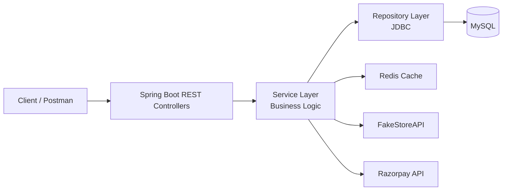

# Amazon-Inspired E-Commerce Backend

A small-scale e-commerce backend built with Java and Spring Boot to model the core customer purchase journey—from product discovery and cart operations through checkout and Razorpay payment integration. The project brings together REST API design, layered business logic, relational persistence, external API integration, and caching in one end-to-end system.

> Independent learning project inspired by common e-commerce workflows. It is not affiliated with or endorsed by Amazon.

## What the system does

- Retrieves product data through the FakeStoreAPI integration.
- Exposes REST endpoints for the application’s e-commerce workflows.
- Supports product selection, cart, checkout, and purchase-related operations.
- Integrates the Razorpay API into the checkout/payment flow.
- Persists customer, product, purchase, and related application data in MySQL.
- Uses JDBC in the repository layer for database access.
- Applies Redis caching to frequently requested results to reduce repeated database reads.

## Architecture

Requests pass through a clear, responsibility-based application structure:

- **Controller layer:** accepts HTTP requests and returns API responses.
- **Service layer:** coordinates workflows and contains core business logic.
- **Repository layer:** reads and writes application data in MySQL using JDBC.
- **Redis:** stores results that are requested frequently, avoiding unnecessary repeat database reads where the cache applies.
- **External integrations:** FakeStoreAPI supplies product data; Razorpay is integrated into the payment flow.

## Example customer journey

1. Retrieve and browse product information.
2. Select products and add them to a cart.
3. Submit a checkout request.
4. Continue through the Razorpay payment flow.
5. Retrieve purchase-related information through the backend APIs.

## Technology

| Area | Technology |
|---|---|
| Language | Java |
| Backend framework | Spring Boot |
| API style | REST |
| Persistence | MySQL with JDBC |
| Caching | Redis |
| Product data integration | FakeStoreAPI |
| Payment integration | Razorpay API |
| API validation | Postman |

## Performance observation

During exploratory Postman testing, response times were observed at approximately **2.2 seconds without the relevant cached result** and **250 milliseconds with Redis caching**—about **89% lower observed latency** in that comparison. Timings varied between runs and requests, so treat this as an indicative local observation rather than a controlled benchmark or guaranteed production result.

For a reproducible comparison, run the same endpoint with identical data and environment, separate the first cache miss from subsequent cache hits, repeat each scenario, and report median and percentile latency with the test setup.

## Design highlights

- **Separation of concerns:** HTTP handling, business logic, and database access live in distinct layers.
- **External service integration:** the backend combines application workflows with catalog and payment APIs.
- **Cache-aware reads:** Redis reduces repeated trips to MySQL for frequently requested results.
- **End-to-end commerce flow:** product selection, cart, checkout, and payment are connected as a coherent customer journey.

## Running locally

The source repository and its build/configuration files were not available while this README was drafted, so exact build commands, required environment-variable names, and endpoint paths are intentionally not guessed. To make this section runnable, document the values used by the application configuration (without secrets), then add:

1. Required Java and build-tool versions.
2. MySQL and Redis startup/configuration steps.
3. FakeStoreAPI and Razorpay configuration, using test credentials and environment variables.
4. The project’s verified build and run commands.
5. A Postman collection or representative API requests.

**Security:** never commit database passwords, Razorpay secrets, access tokens, or other credentials. Use environment variables or a local, ignored configuration file.

## Testing the flow

Use Postman to exercise the APIs in sequence: product retrieval → cart operations → checkout → Razorpay payment flow → purchase retrieval. Keep test data and payment credentials in a non-production environment. Add the collection and expected responses here when available.

## Future improvements

- Publish API documentation and example request/response payloads.
- Add automated unit and integration tests for service, repository, cache, and payment flows.
- Add repeatable load-test results for cached and uncached requests.
- Document cache expiration and invalidation behavior.
- Add deployment and observability guidance if the project is deployed.

## About

A portfolio project demonstrating Java backend development, Spring Boot, REST APIs, JDBC, MySQL, Redis caching, third-party API integration, and payment workflow implementation.
